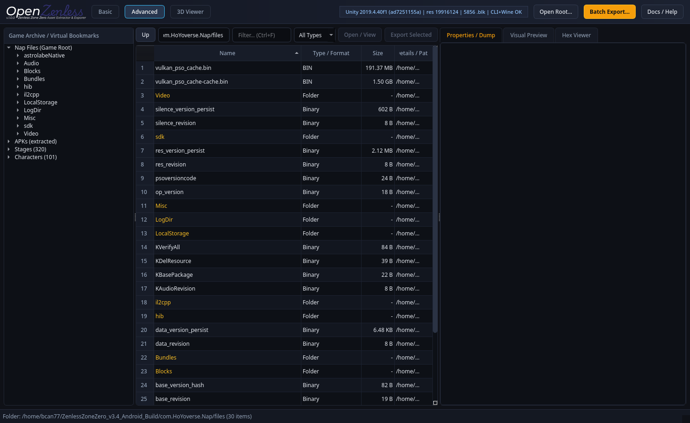
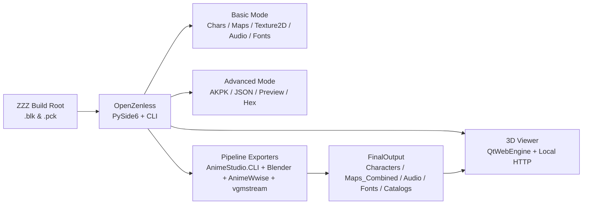

<div align="center">
  
  <p><strong>Zenless Zone Zero asset viewer & extractor, for the people who just want to create!.</strong></p>
  

  <p>
    
    
    
    
  </p>
</div>

---

*NOTE : This program is HIGHLY EXPERIMENTAL, and may not work on your device. Windows support is unavailable until I can manage to verify that this build can export and view all textures/assets reliably.*

## How the program works;

- **3 Viewer Model (`Basic` | `Advanced` | `3D Viewer`)**
  - **Basic**: Browse organized **Characters**, **Curated Maps**, **Texture2D Sections** (UI, Comics, Story, Season 2, Effects, etc.), **Audio Archives**, and **Fonts** with options for neatly exporting them.
  - **Advanced Mode**: OpenIV-style raw archive browser for `.blk` containers, Wwise `.pck` (`AKPK`) packages, Unity asset JSON dumps, PNG texture previews, and a 4 KB paged Hex + ASCII viewer.
  - **3D Viewer**: Embedded `QWebEngineView` serving the interactive Three.js GLB + Catalog viewer for exported characters, animations, facial morphs, and maps.
- **Scoped & Full Pipeline Exports**
  - Whole Characters (FBX + Textures + Blender GLB + Facial Morphs)
  - Character Animations Only (`AnimationClip` / `Animator` / `Avatar`)
  - Curated Maps vs. Raw Stages (separated cleanly)
  - Fonts (`.ttf` / `.otf`) & Custom Unity Asset Types (`Texture2D`, `Sprite`, `Shader`, `TextAsset`, `Mesh`, etc.)
  - Wwise `.pck` Auto-Naming & Voice Organization via `AnimeWwise` (`nap.map`) + optional `.wem` → `.wav` decoding via `vgmstream-cli`
- **Live Build & Environment Verification**
  - Reads `psoversioncode`, `base_revision`, `res_revision`, `data_revision`, `audio_revision`, `silence_revision`, `op_version`, `.blk`/`.pck` counts, and `AnimeStudio.CLI` + `Wine` health.

---

## 📸 Screenshots

### Basic Mode (Organized Asset Browser)


### Advanced Mode (OpenIV-Style Container & Hex Inspector)


### Batch & Pipeline Export Wizard


---

## 🏗️ Architecture



---

## 🚀 Quick Start

```bash
# Install Python dependencies
pip install -r requirements.txt

# Launch the desktop GUI
./run.sh

# Or run CLI commands directly
./run.sh version
./run.sh export full --dry-run
```

### Environment Variables (Optional)
| Variable | Default | Description |
| :--- | :--- | :--- |
| `ZZZ_GAME_ROOT` | `~/.config/openzenless/config.json` (`$HOME` fallback) | Path to ZZZ installation root |
| `ZZZ_FINAL_OUTPUT` | `~/OpenZenless_Output` | Path to output directory (exports, `Extractor/`, `Viewer/`) |
| `ZZZ_BLK_EXPLORER_CACHE` | `$TMPDIR/zzz_blk_explorer` | Cache directory for decoded previews, asset maps & `.blk` JSON dumps |

---

## 📚 Documentation

- **[GUI Guide](docs/GUI.md)** — Walkthrough of Basic Mode, Advanced Mode, 3D Viewer, Batch Export, and shortcuts.
- **[CLI Reference](docs/CLI.md)** — Full command reference for `version`, `inspect`, `unpack-pck`, `scan-blk`, and `export`.
- **[Mobile (Android) Extraction Guide](docs/MOBILE_EXTRACTION.md)** — How to copy your mobile ZZZ build (`com.HoYoverse.Nap`) to PC via ADB or Shizuku.
- **[PC Copy Guide](docs/PC_GUIDE.md)** — How to browse and export directly from a PC (Windows) installation of ZZZ.
- **[Assets](assets/README.md)** — Brand logo variants.
