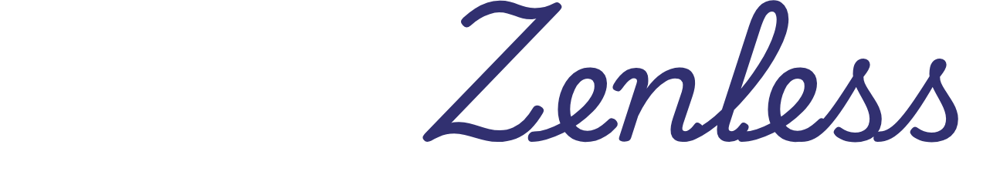
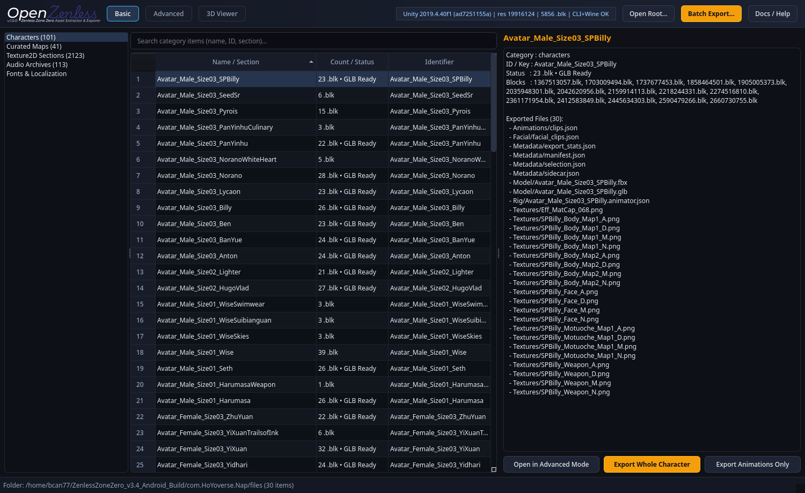
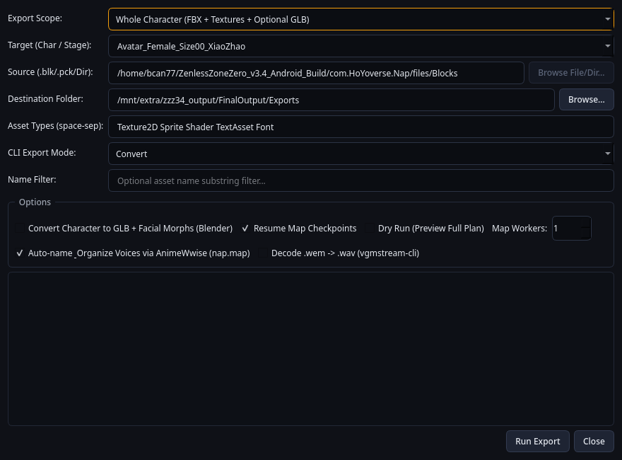
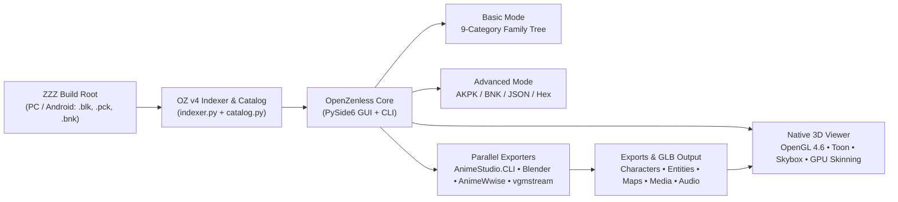

<div align="center">
  

  <h3>Zenless Zone Zero asset browser, native 3D inspector & batch exporter — built for creators.</h3>

  <p>
    <a href="https://github.com/bcan77/OpenZenless/releases">
      
    </a>
    
    
    
    <a href="LICENSE">
      
    </a>
  </p>

  <p>
    <a href="#-what-you-can-browse--export">Asset Coverage</a> •
    <a href="#-three-workspaces">Workspaces</a> •
    <a href="#-native-gpu-3d-viewer">3D Viewer</a> •
    <a href="#-screenshots">Screenshots</a> •
    <a href="#-quick-start">Quick Start</a> •
    <a href="#-cli-examples">CLI</a> •
    <a href="#-documentation">Docs</a>
  </p>
</div>

---

> [!WARNING]
> **Experimental Linux-first release:** OpenZenless is under active development and may not work out of the box on every system. Native Windows support is not yet verified — the app currently targets **Linux** (with `Wine` for `AnimeStudio.CLI.exe`).

---

## ✨ What You Can Browse & Export

Powered by the **OZ v4 Indexer** (`AnimeStudio.CLI` + `openzenless/catalog.py`), OpenZenless scans both **PC (Windows)** and **Android** (including split APK) Zenless Zone Zero builds and organizes assets into **9 browsable categories**:

| Category | What's Included | Export Formats & Highlights |
| :--- | :--- | :--- |
| **Characters** | Collapsible family tree grouping playable Agents with skins, alt forms (e.g., *Anby / Soldier 0 - Anby*, *Billy / SP Billy*, *Aria / Aria Robot*), companions & signature weapons | Whole Character (`.fbx`, textures, optional Blender `.glb` + facial morphs), **Animations Only**, or one-click **Export Family** |
| **Bangboo** | Dedicated Bangboo models, rigs, textures & normalized animation clips | Full character/rig export (`.fbx` / `.glb`) & animations |
| **Monsters & Bosses** | Full enemy & boss 3D models, materials, and combat animations | Full entity export (`.fbx` / `.glb`) & animations |
| **NPCs** | Story and overworld NPC models with gender/size-normalized `NPC_*_Ani_*` animation matching | Full entity export (`.fbx` / `.glb`) & animations |
| **W-Engines & Props** | Weapons, W-Engines, character accessories, and environment props | `.fbx` / `.glb` & textures |
| **Curated Maps & Stages** | Filtered playable/overworld curated maps (with streaming `extra_scenes` & `BaseScene` merged) separated cleanly from raw stages | Parallel multi-worker map pipeline with resume checkpoints & combined `.glb` output |
| **UI, Sprites & Spine 2D** | Spine 2D rigs (`.skel` / `.atlas`), 8 curated UI Sprite packs, and filtered `Texture2D` sections (Comics, Story, Effects, etc.) | Raw/converted PNGs, Spine 2D bundles & split-APK-safe texture exports |
| **Audio (`.pck` & `.bnk`)** | Wwise `AKPK` `.pck` archives and RIFF `.bnk` (`BKHD`/`DIDX`/`DATA`) SoundBanks | `AnimeWwise` (`nap.map`) auto-naming & lazy voice grouping, embedded `.bnk` WEM extraction, and parallel `.wem → .wav` decoding via `vgmstream-cli` |
| **Fonts & Game Data** | Fast indexed `.ttf` / `.otf` fonts, per-`.blk` Shaders, and structured Game Data packs | Direct indexed extraction without scanning unrelated `.blk` containers |

---

## 🖥️ Three Workspaces

### 1. Basic Mode — Organized Asset Browser
- Collapsible **`QTreeWidget`** across all 9 categories with live search and type sub-filters.
- Inspect block counts, container lists, and existing exports at a glance before exporting.
- One-click **Export Whole Character / Entity**, **Export Animations Only**, **Export Family**, optional **Shaders** and **Extract `.bnk` WEMs** toggles, plus **Open in Advanced Mode** to jump straight to the underlying `.blk` files.

### 2. Advanced Mode — OpenIV-Style Archive & Hex Inspector
- Browse `Blocks/`, `Audio/`, `il2cpp/Metadata/`, `Video/`, extracted split APKs, and virtual Stage/Character bookmarks.
- Natively unpack and inspect **Wwise `.pck` (`AKPK`)** packages and **`.bnk` SoundBanks** directly in the file table.
- Dump Unity asset JSONs from `.blk` containers via `AnimeStudio.CLI.exe`, preview decoded PNG/JPG/WebP textures, or inspect raw binaries in a **4 KB paged Hex + ASCII viewer** with `0x...` offset jumping.
- Live **Build & Environment Check** pill displaying Unity `psoversioncode`, `base_revision`, `res_revision`, `data_revision`, `audio_revision`, `.blk`/`.pck` counts, and `AnimeStudio.CLI` + `Wine` status.

### 3. Native GPU 3D Viewer
- Built natively on **`QOpenGLWidget` (OpenGL 4.6 CompatibilityProfile)** with `4x` MSAA, `8x` anisotropic filtering, and automatic discrete GPU PRIME offload (NVIDIA & AMD) — no embedded browser or WebEngine overhead.
- **GPU Vertex-Shader Bone Skinning** (`GL_RGBA32F` bone palette) with real-time Unity `AnimationClip` playback, timeline scrubbing, and rest/animated pose switching.
- **7 Game-Calibrated ZZZ Toon Shader Presets** sourced from in-game `WeatherConfig`, Ramp, LUT, and SkyLight assets (`assets/toon_presets/`):
  `Outdoors (Day)` • `Sunrise (Dawn)` • `Sunset (Dusk)` • `In-Building (Indoor)` • `Night (Neon City)` • `Overcast / Rainy` • `Studio (Agent UI)`
- **Atmospheric Skybox Dome Shader** with extracted in-game cloud maps (`HighCloudMap_01`, `LowCloudMap_02`, `SkyCloud`), auto-enabled on maps with a toolbar toggle.
- **WASD + Fly Cam Controls** (auto-enabled on maps):
  - `WASD` / Arrow keys — Move • `Q` / `C` — Down • `E` / `Space` — Up
  - `Shift` — Fast • `Ctrl` — Slow • `F` — Toggle Fly / Orbit Cam • `R` / `Home` — Reset Camera
  - Toolbar toggles for **Wireframe**, **Textures**, **Skybox**, **Fly Cam**, **Toon Shader**, **Culling**, and **Zoom LOD**.
- Browses exported **Characters**, **Bangboo**, **Monsters & Bosses**, **NPCs**, **W-Engines & Props**, and **Curated Maps** (`.glb` / `.obj`), or opens any standalone model file.

---

## 📸 Screenshots

> [!NOTE]
> Screenshots below are from an earlier build and will be refreshed alongside the upcoming UI/3D Viewer showcase banners.

### Basic Mode (Organized Asset Browser)


### Advanced Mode (OpenIV-Style Container & Hex Inspector)


### Batch & Pipeline Export Wizard


---

## 🏗️ Architecture



---

## 🚀 Quick Start

### Option A — Linux AppImage (Fastest)
Download the latest `OpenZenless-*-x86_64.AppImage` from [**GitHub Releases**](https://github.com/bcan77/OpenZenless/releases):

```bash
chmod +x OpenZenless-*-x86_64.AppImage

# Launch the GUI
./OpenZenless-*-x86_64.AppImage

# Or invoke any CLI command directly
./OpenZenless-*-x86_64.AppImage version
```

### Option B — Run from Source
Requires **Python 3.10+**.

```bash
# Install core GUI dependencies
pip install -r requirements.txt

# Install Native 3D Viewer dependencies (OpenGL + GLB loader)
pip install numpy PyOpenGL pygltflib

# Launch the desktop GUI (opens Initial Setup on first run)
./run.sh
```

### External Toolchain
OpenZenless can automatically clone and build **`AnimeStudio.CLI`** (with OpenZenless's OZ v4 index dumper & `AnimeStudio.ACL.ZZZV2.dll`) and **`AnimeWwise`** (`nap.map`) into `~/.local/share/openzenless/tools/` via **Batch Export → Setup / Build Tools**.

| Tool | Required For |
| :--- | :--- |
| `wine` + `.NET 9 SDK` (`dotnet`) + `git` | Building & running `AnimeStudio.CLI.exe` on Linux (`.blk` indexing, meshes, textures, animations) |
| `x86_64-w64-mingw32-g++` *(optional)* | Compiling native `AnimeStudio.ACL.ZZZV2.dll` for ZZZ ACL animation decompression |
| `blender` *(optional)* | Converting exported `.fbx` rigs/maps to `.glb` + facial morphs (with Cycles OPTIX/CUDA acceleration) |
| `vgmstream-cli` *(optional)* | Parallel `.wem → .wav` audio decoding |
| `adb` *(optional)* | Pulling game files and split APKs directly from an Android device |

---

## 📂 Loading Your ZZZ Build

On first launch (or anytime via **Open Root...**), choose one of three sources:

1. **Load from Android Phone (ADB)** *(recommended for Android players)*
   - Enable **USB Debugging**, connect your device, and click **Load from Phone (ADB)...** (or run `./run.sh pull-phone --dest ~/OpenZenless_ZZZ_Android`).
   - Streams live transfer progress via POSIX PTY with remote size probing, timestamped logs, and a determinate progress bar; automatically detects `com.HoYoverse.Nap` / `com.miHoYo.Nap`, pulls assets (`Blocks/`, `Audio/`, `il2cpp/`, revisions), pulls split APKs, and extracts base `.blk` files from `split_UnityDataAssetPack.apk`.
   - *(On Android 13–15, if Scoped Storage restricts `/sdcard/Android/data/`, stage `files/` with Shizuku into `/sdcard/Download/com.HoYoverse.Nap/files/` first — see the [Mobile Extraction Guide](docs/MOBILE_EXTRACTION.md).)*
2. **Existing Android Build Folder**
   - Browse to any pre-copied Android dump folder containing `com.HoYoverse.Nap/files/` or `files/`.
3. **PC (Windows) Installation**
   - Browse to `ZenlessZoneZero Game/`, `ZenlessZoneZero_Data/`, or `StreamingAssets/` — see the [PC Copy Guide](docs/PC_GUIDE.md).

> Next, build the local **OZ v4 Asset Map** when prompted so all 9 Basic Mode categories, character family trees, and fast indexed exports populate automatically.

---

## ⌨️ CLI Examples

```bash
# Check build revisions, container counts & tool health
./run.sh version

# Pull Android build & split APKs over ADB
./run.sh pull-phone --dest ~/OpenZenless_ZZZ_Android

# Export a character (FBX + textures + optional Blender GLB) or animations only
./run.sh export character --name Avatar_Female_Size02_Anby --glb --out-dir ./Exports
./run.sh export animations --name Avatar_Female_Size02_Anby --out-dir ./Exports

# Export Monsters, NPCs, Weapons/Props, Curated Maps, Spine 2D, UI Sprites, or Game Data
./run.sh export monster --name Boss_Name --glb --out-dir ./Exports
./run.sh export map --name FortuneHIA --workers 4 --out-dir ./Exports
./run.sh export spine --name SpineRigName --out-dir ./Exports
./run.sh export sprites --name PackName --out-dir ./Exports
./run.sh export data --name DataPackName --out-dir ./Exports

# Fast indexed fonts & Wwise audio (.pck + embedded .bnk WEMs + WAV decode)
./run.sh export fonts --out-dir ./Exports
./run.sh export audio --wav --out-dir ./Exports

# Preview a full pipeline export without writing files
./run.sh export full --dry-run
```

---

## ⚙️ Environment Variables

| Variable | Default | Description |
| :--- | :--- | :--- |
| `ZZZ_GAME_ROOT` | `~/.config/openzenless/config.json` (`$HOME` fallback) | Path to ZZZ Android or PC build root |
| `ZZZ_FINAL_OUTPUT` | `~/OpenZenless_Output` *(or local `FinalOutput/`)* | Destination root for exports & viewer catalogs |
| `ZZZ_BLK_EXPLORER_CACHE` | `~/.local/share/openzenless/cache` | Cache directory for OZ v4 asset maps, previews & `.blk` JSON dumps |
| `ANIMESTUDIO_CLI` | Auto-detected in `~/.local/share/openzenless/tools/` | Explicit path override for `AnimeStudio.CLI.exe` |
| `OPENZENLESS_GPU` | Auto discrete GPU PRIME offload (NVIDIA / AMD) | Set to `igpu`, `cpu`, `0`, or `off` to disable discrete GPU offload |

---

## 📚 Documentation

- **[GUI Guide](docs/GUI.md)** — Walkthrough of Basic Mode, Advanced Mode, 3D Viewer, Batch Export, and shortcuts (`Ctrl+F`, `Ctrl+E`, `F5`).
- **[CLI Reference](docs/CLI.md)** — Command reference for `gui`, `version`, `inspect`, `unpack-pck`, `scan-blk`, `pull-phone`, and `export`.
- **[Mobile (Android) Extraction Guide](docs/MOBILE_EXTRACTION.md)** — Pulling `com.HoYoverse.Nap` via built-in ADB, manual ADB, or Shizuku.
- **[PC Copy Guide](docs/PC_GUIDE.md)** — Using OpenZenless directly with a PC (Windows) installation of ZZZ.
- **[Brand Assets](assets/README.md)** — Logos and header image specifications.

---

## 🙏 Credits & Legal

- Built on top of community tooling including **AnimeStudio**, **AnimeWwise**, **vgmstream**, **Blender**, and **PySide6 / OpenGL**.
- **License:** Distributed under the [Apache License 2.0](LICENSE).
- **Disclaimer:** OpenZenless is an independent, fan-made tool for viewing and exporting assets from your own copy of *Zenless Zone Zero*. It is not affiliated with, endorsed by, or associated with HoYoverse / miHoYo. All game assets remain the property of their respective copyright holders.
